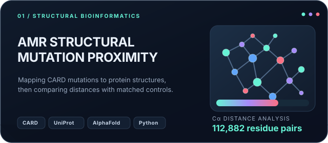
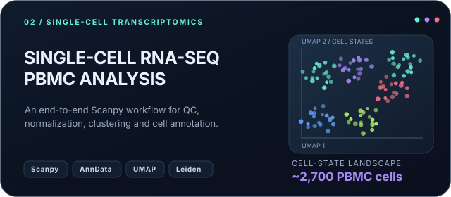
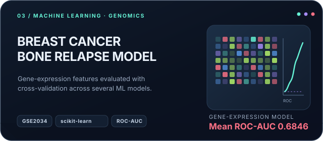
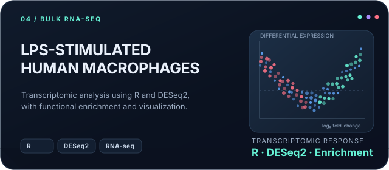

 

 

 

## `01 // PROFILE SIGNAL`

I’m a Biotechnology graduate from Gomal University exploring the overlap between **bioinformatics, computational biology, genomics, and machine learning**. I like turning biological questions into reproducible computational workflows, from transcriptomic analysis to protein-structure measurements.

My projects are a work in progress, and I try to document methods, results, and limitations clearly so that the analysis can be inspected and reproduced.

<table>
  <tr>
    <td width="33%" valign="top">
      <h3>⌁ Genomics</h3>
      Biological data, gene-expression analysis, sequence workflows, and reproducible data processing.
    </td>
    <td width="33%" valign="top">
      <h3>◌ Transcriptomics</h3>
      Bulk RNA-seq and single-cell analysis, quality control, dimensionality reduction, and cell populations.
    </td>
    <td width="33%" valign="top">
      <h3>⌬ Structural + ML</h3>
      Protein structures, resistance mutations, feature selection, and exploratory predictive modelling.
    </td>
  </tr>
</table>

## `02 // SELECTED WORK`

The cards below are designed as clickable project covers. They are static SVG artwork inside the README; clicking one opens the underlying repository. The interactive structure viewer is linked separately.

<table>
  <tr>
    <td width="50%" valign="top">
      
      
<a href="https://github.com/talharaziq/amr-structural-epistasis"><b>Open repository ↗</b></a> &nbsp;·&nbsp; <a href="https://talharaziq.github.io/tb-amr-structural-epistasis/figure3_interactive.html">Interactive protein viewer ↗</a>

    </td>
    <td width="50%" valign="top">
      
      
<a href="https://github.com/talharaziq/scRNAseq-PBMC-Analysis"><b>Open repository ↗</b></a>

    </td>
  </tr>
  <tr>
    <td width="50%" valign="top">
      
      
<a href="https://github.com/talharaziq/breast-cancer-bone-relapse-prediction"><b>Open repository ↗</b></a>

    </td>
    <td width="50%" valign="top">
      
      
<a href="https://github.com/talharaziq/human-macrophage-lps-rnaseq"><b>Open repository ↗</b></a>

    </td>
  </tr>
</table>

  
<b>Notes on the research results</b>

   
  The AMR structural project measures the spatial proximity of resistance-associated positions listed by CARD against matched random residue pairs. The listed mutations are not shown to co-occur or depend on one another, so the analysis does <i>not</i> establish genetic epistasis. The reported distances come from one run and have limitations described in the repository.
    
  The breast-cancer model is exploratory and uses one public dataset. Its current cross-validated ROC-AUC is moderate; it is not a clinically validated prediction tool and has not had independent external validation.

## `03 // TOOLKIT`

<table>
  <tr>
    <td width="50%" valign="top">
      <b>Programming & data</b> 
      Python · R · NumPy · Pandas · Matplotlib · Seaborn
    </td>
    <td width="50%" valign="top">
      <b>Bioinformatics</b> 
      Scanpy · AnnData · Biopython · DESeq2 · GEO / NCBI
    </td>
  </tr>
  <tr>
    <td width="50%" valign="top">
      <b>Machine learning</b> 
      scikit-learn · feature selection · cross-validation · model evaluation
    </td>
    <td width="50%" valign="top">
      <b>Research computing</b> 
      Jupyter · Google Colab · Linux · Git · UniProt · AlphaFold DB
    </td>
  </tr>
</table>

*This list describes tools represented in my projects and learning path; it is not a claim of equal proficiency across every tool.*

## `04 // GITHUB TELEMETRY`

 

Language percentages are based on the code present in eligible public repositories. They measure repository composition, not personal proficiency. Third-party statistics images can occasionally be rate-limited or unavailable.

## `05 // CONTRIBUTION MATRIX`

The snake animation is generated from the public GitHub contribution calendar by the included GitHub Actions workflow. After you upload the files, run **Actions → Generate contribution snake → Run workflow** once; it will also refresh daily.

<picture>
  <source media="(prefers-color-scheme: dark)" srcset="https://raw.githubusercontent.com/talharaziq/talharaziq/output/github-snake-dark.svg" />
  <source media="(prefers-color-scheme: light)" srcset="https://raw.githubusercontent.com/talharaziq/talharaziq/output/github-snake.svg" />
  
</picture>

## `06 // RESEARCH & BACKGROUND`

**Publication**  
Raziq, T. (2025). *Chloroplast Genetic Engineering in Crop Plants: Techniques and Applications.* International Journal of Agriculture Environment and Food Sciences, 9(Special), 239–246. [Read the publication ↗](https://doi.org/10.31015/2025.si.10)

**Research experience**  
Research Intern — Biotechnology, National Institute for Genomics and Advanced Biotechnology (NIGAB), National Agricultural Research Centre (NARC), Islamabad, Pakistan · June–July 2025.

**Selected training**  
[Python for Genomic Data Science — Johns Hopkins University](https://www.coursera.org/account/accomplishments/verify/JJGLG3JTKQEE) · [Biomedical Visualization — University of Glasgow](https://www.coursera.org/account/accomplishments/verify/WTHG4YI8BDUS) · Genomic Data Science — Johns Hopkins University.

**Membership**  
Member, American Society for Microbiology.

## `07 // FIND ME`

  

Built around biology, measured with code, documented in the open.

