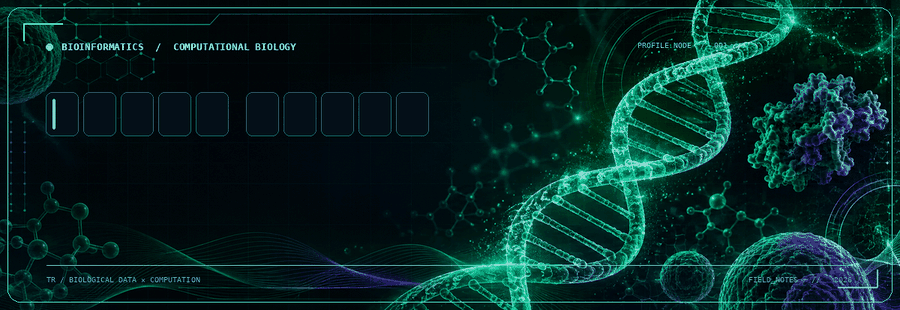

  

  

    
  

  

    
    
    
    
    
    
  

  

## 01 / ABOUT

I’m **Talha Raziq**, a Biotechnology graduate from **Gomal University**, Dera Ismail Khan, Pakistan. I’m building toward computational approaches to biological questions, bringing together biological systems, data analysis and code.

My interests sit at the intersection of **bioinformatics, computational biology, genomics and artificial intelligence / machine learning**. I enjoy turning biological data into interpretable results through research-oriented projects and reproducible computational workflows.

> *Biology is the language. Data is the lens.*

## 02 / RESEARCH INTERESTS

<table>
  <tr>
    <td width="33%" valign="top">
      <strong>01 · BIOINFORMATICS</strong>  
      Sequence analysis, computational genomics and biological data workflows.
    </td>
    <td width="33%" valign="top">
      <strong>02 · COMPUTATIONAL BIOLOGY</strong>  
      Programming, statistics and computational methods for biological questions.
    </td>
    <td width="33%" valign="top">
      <strong>03 · AI / MACHINE LEARNING</strong>  
      Data-driven methods and predictive modelling for life-science applications.
    </td>
  </tr>
</table>

## 03 / SELECTED PROJECTS

<table>
  <tr>
    <td width="50%" valign="top">
      
<strong>01 / AMR STRUCTURAL MUTATION PROXIMITY</strong>

      
Python workflow examining the 3D proximity of antimicrobial-resistance mutations using CARD mutation data and UniProt / AlphaFold protein structures. Observed mutation pairs were compared with matched controls.

      

        
        
        
        
      

      
<a href="https://github.com/talharaziq/amr-structural-epistasis">SOURCE CODE ↗</a> · <a href="https://talharaziq.github.io/tb-amr-structural-epistasis/figure3_interactive.html">INTERACTIVE STRUCTURE ↗</a>

    </td>
    <td width="50%" valign="top">
      
<strong>02 / SINGLE-CELL RNA-SEQ PBMC ANALYSIS</strong>

      
Scanpy- and AnnData-based workflow for approximately 3,000 peripheral blood mononuclear cells. Includes quality control, normalization, PCA, Leiden clustering and UMAP visualization.

      

        
        
        
      

      
<a href="https://github.com/talharaziq/scRNAseq-PBMC-Analysis">VIEW PROJECT ↗</a>

    </td>
  </tr>
  <tr>
    <td width="50%" valign="top">
      
<strong>03 / BREAST CANCER BONE RELAPSE PREDICTION</strong>

      
Machine-learning analysis of the GSE2034 gene-expression dataset. Compared Logistic Regression, Linear SVM and Random Forest after preprocessing, gene annotation and feature selection.

      

        
        
        
      

      
<a href="https://github.com/talharaziq/breast-cancer-bone-relapse-prediction">VIEW PROJECT ↗</a>

    </td>
    <td width="50%" valign="top">
      
<strong>MORE RESEARCH WORK</strong>

      
Browse my repositories for additional experiments, analysis notebooks and learning projects across biological data and computational workflows.

      
<a href="https://github.com/talharaziq?tab=repositories">EXPLORE ALL REPOSITORIES ↗</a>

    </td>
  </tr>
</table>

  

## 04 / EXPERIENCE

**Research Intern — Biotechnology** · June–July 2025  
National Institute for Genomics and Advanced Biotechnology (**NIGAB**), National Agricultural Research Centre (**NARC**), Islamabad, Pakistan.

## 05 / PUBLICATION

**Chloroplast Genetic Engineering in Crop Plants: Techniques and Applications**  
Raziq, T. (2025). *International Journal of Agriculture Environment and Food Sciences*, 9(Special), 239–246.

[READ THE PUBLICATION · DOI: 10.31015/2025.si.10 ↗](https://doi.org/10.31015/2025.si.10)

## 06 / TOOLKIT

**Programming & data**  
    

**Bioinformatics & research**  
    

**Computing**  
   

## 07 / TRAINING & MEMBERSHIP

- **Biomedical Visualization** — University of Glasgow · [Verify certificate](https://www.coursera.org/account/accomplishments/verify/WTHG4YI8BDUS)
- **Python for Genomic Data Science** — Johns Hopkins University · [Verify certificate](https://www.coursera.org/account/accomplishments/verify/JJGLG3JTKQEE)
- **Genomic Data Science** — Johns Hopkins University
- **Member** — American Society for Microbiology · [Membership certificate](https://drive.google.com/file/d/1WgWLQ6Zc2LWKHI4Ft0ycKR_cPMKJPgZ0/view)

## 08 / EDUCATION

**Bachelor’s Degree in Biotechnology**  
Gomal University · Dera Ismail Khan, Pakistan

## 09 / GITHUB ACTIVITY

  
  

  

---

  <strong>BIOLOGY IN · COMPUTATION THROUGH · INSIGHT OUT</strong> 
  For research conversations, collaboration or professional inquiries: <a href="mailto:talha47raziq@gmail.com">talha47raziq@gmail.com</a>  
  <a href="https://talharaziq.github.io/">PORTFOLIO</a> · <a href="https://github.com/talharaziq">GITHUB</a> · <a href="https://pk.linkedin.com/in/talharaziq">LINKEDIN</a> · <a href="https://scholar.google.com/citations?user=6vRb9FUAAAAJ&hl=en">GOOGLE SCHOLAR</a>

