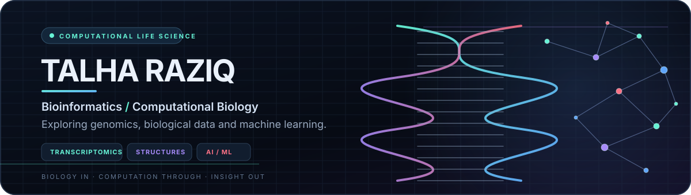

  <a href="https://talharaziq.github.io/">Portfolio</a> ·
  <a href="https://orcid.org/0009-0006-2594-5715">ORCID</a> ·
  <a href="https://scholar.google.com/citations?user=6vRb9FUAAAAJ&hl=en">Google Scholar</a> ·
  <a href="https://pk.linkedin.com/in/talharaziq">LinkedIn</a> ·
  <a href="mailto:talha47raziq@gmail.com">Email</a>

---

## About

I’m a Biotechnology graduate from Gomal University exploring the overlap between **bioinformatics, computational biology, genomics, and machine learning**. I use computational workflows to investigate biological questions, from gene-expression patterns to protein-structure measurements, with an emphasis on clear and reproducible analysis.

## Research interests

**Genomics** · **Bulk RNA-seq** · **Single-cell analysis** · **Protein structures** · **Machine learning**

## Selected projects

- **[AMR Structural Mutation Proximity Analysis](https://github.com/talharaziq/amr-structural-epistasis)** — Explore the structural proximity of antimicrobial-resistance mutations using CARD, UniProt, AlphaFold and Python. [Open the interactive protein viewer](https://talharaziq.github.io/tb-amr-structural-epistasis/figure3_interactive.html).
- **[Single-cell RNA-seq PBMC Analysis](https://github.com/talharaziq/scRNAseq-PBMC-Analysis)** — A Scanpy-based workflow for quality control, dimensionality reduction and analysis of PBMC single-cell data.
- **[Breast Cancer Bone Relapse Prediction](https://github.com/talharaziq/breast-cancer-bone-relapse-prediction)** — Explore gene-expression data for bone-relapse prediction.
- **[Human Macrophage LPS RNA-seq](https://github.com/talharaziq/human-macrophage-lps-rnaseq)** — RNA-seq analysis of LPS-stimulated human macrophages using R and DESeq2.

## Toolkit

**Programming and data:** Python, R, NumPy, pandas, Matplotlib, Seaborn

**Bioinformatics:** Scanpy, AnnData, Biopython, DESeq2, GEO / NCBI, UniProt, AlphaFold DB

**Machine learning:** scikit-learn, feature selection, cross-validation, model evaluation

**Research computing:** Jupyter, Google Colab, Linux, Git, VS Code

## GitHub stats

  
  

  

## Research and background

**Publication**

Raziq, T. (2025). *Chloroplast Genetic Engineering in Crop Plants: Techniques and Applications.* International Journal of Agriculture Environment and Food Sciences, 9(Special), 239–246. [Read the publication](https://doi.org/10.31015/2025.si.10).

**Research experience**

Research Intern — Biotechnology, National Institute for Genomics and Advanced Biotechnology (NIGAB), National Agricultural Research Centre (NARC), Islamabad, Pakistan · June–July 2025.

**Selected training**

[Python for Genomic Data Science — Johns Hopkins University](https://www.coursera.org/account/accomplishments/verify/JJGLG3JTKQEE) · [Biomedical Visualization — University of Glasgow](https://www.coursera.org/account/accomplishments/verify/WTHG4YI8BDUS) · Genomic Data Science — Johns Hopkins University.

**Membership**

Member, American Society for Microbiology.

---

  Biology, code, and reproducible research.

